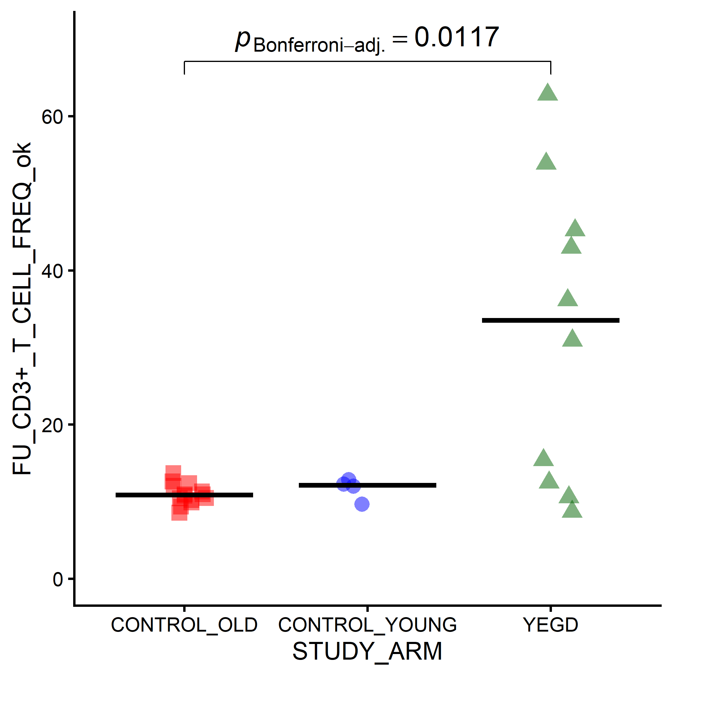

```{r, echo=FALSE, results='hide'}
knitr::opts_chunk$set(message = FALSE,  
                      warning = FALSE,
                      results = "hide")   
```

**Cần sắp xếp theo đúng thứ tự cột `x_ok` rồi mới vẽ đồ thị.**

**Chỗ lệnh `p_gtable$grobs[[5]]`, thỉnh thoảng version cũ `ggplot2` sẽ chỉnh về `p_gtable$grobs[[6]]` hoặc ta sẽ dò thủ công lại vị trí của các grid object này.**

**Download dataset [`df2`](https://filedn.com/lesyJpQOCafj7katNqunAxu/SHARE/df2.rds)**

```{r, results='hold'}
# df <- PlantGrowth
# names(df) <- c("y_ok", "x_ok")
# 
# library(dplyr)
# df |> dplyr:::arrange(x_ok) -> df
# 
# df

df <- readRDS(paste0(getwd(), "/df2.rds"))

df <- df[ , -5]


library(dplyr)
df |> dplyr:::arrange(STUDY_ARM) -> df

df
```


```{r}
library(ggstatsplot)
library(ggplot2)
library(grid)
library(gridExtra)

png(filename = paste0(getwd(), "/g1.png"),
    width = 8,
    height = 8,
    units = "in",
    res = 300)


# options(scipen = 4)
# options(digits = 4)
# options(pillar.sigfig = 4)


p1 <- ggbetweenstats(
  
                     # data = df,
                     # x = x_ok,
                     # y = y_ok,
                     
                     data = df,
                     x = STUDY_ARM,
                     y = `FU_CD3+_T_CELL_FREQ_ok`,
                     
                     
                     type = "nonparametric", 
                     plot.type = "box",
                     pairwise.comparisons = T,
                     pairwise.display = "significant",
                     p.adjust.method = "bonferroni",
                     centrality.plotting = F,
                     centrality.path = FALSE,
                     digits = 4L,
                     ggtheme = theme_classic(base_size = 20),
                     bf.message = F,
                     results.subtitle = F,
                     caption = "",
                     ggsignif.args = list(size = 0.5,
                                          vjust = 0,
                                          step_increase = 0.15,
                                          textsize = 8),
                     violin.args = list(width = 0, linewidth = 0, colour = NA),
                     boxplot.args = list(width = 0),
                     point.args = list(position = ggplot2::position_jitterdodge(dodge.width = 0.6),
                                       alpha = 1,
                                       size = 6,
                                       stroke = 0, 
                                       na.rm = TRUE),
                     ) +
  
  theme(legend.position = "none") +
  
  geom_boxplot(median.color = "black",
               color = NA,
               fill = NA) +
  
  labs(color = "Note") +
  
  coord_cartesian(ylim = c(0, 70),
                  clip = "off")

b1 <- ggplot_build(p1)
p_gtable <- ggplot_gtable(b1)

p_gtable -> p_gtable_ori

library(lemon)
lemon::gtable_show_names(p_gtable)

p_gtable$grobs[[13]]$children[[1]]$label <- NULL

p_gtable$grobs[[5]]$children[[4]] <- NULL

# chinh so luong o day, check table(df$STUDYARM)
p_gtable$grobs[[5]]$children[[3]]$pch <- c(rep(15,
                                             times = 14),
                                           rep(16,
                                               times = 4),
                                           rep(17,
                                               times = 10)
                                           )

# chinh so luong o day, check table(df$STUDYARM)
p_gtable$grobs[[5]]$children[[3]]$gp$col <- c(rep(adjustcolor(col = "red", alpha.f = 0.5),
                                                  times = 14),
                                              rep(adjustcolor(col = "blue", alpha.f = 0.5),
                                                  times = 4),
                                              rep(adjustcolor(col = "darkgreen", alpha.f = 0.5),
                                                  times = 10)
)

grid::grid.newpage()
grid::grid.draw(p_gtable)


dev.off()
```

{width=70%}

```{r}

```

